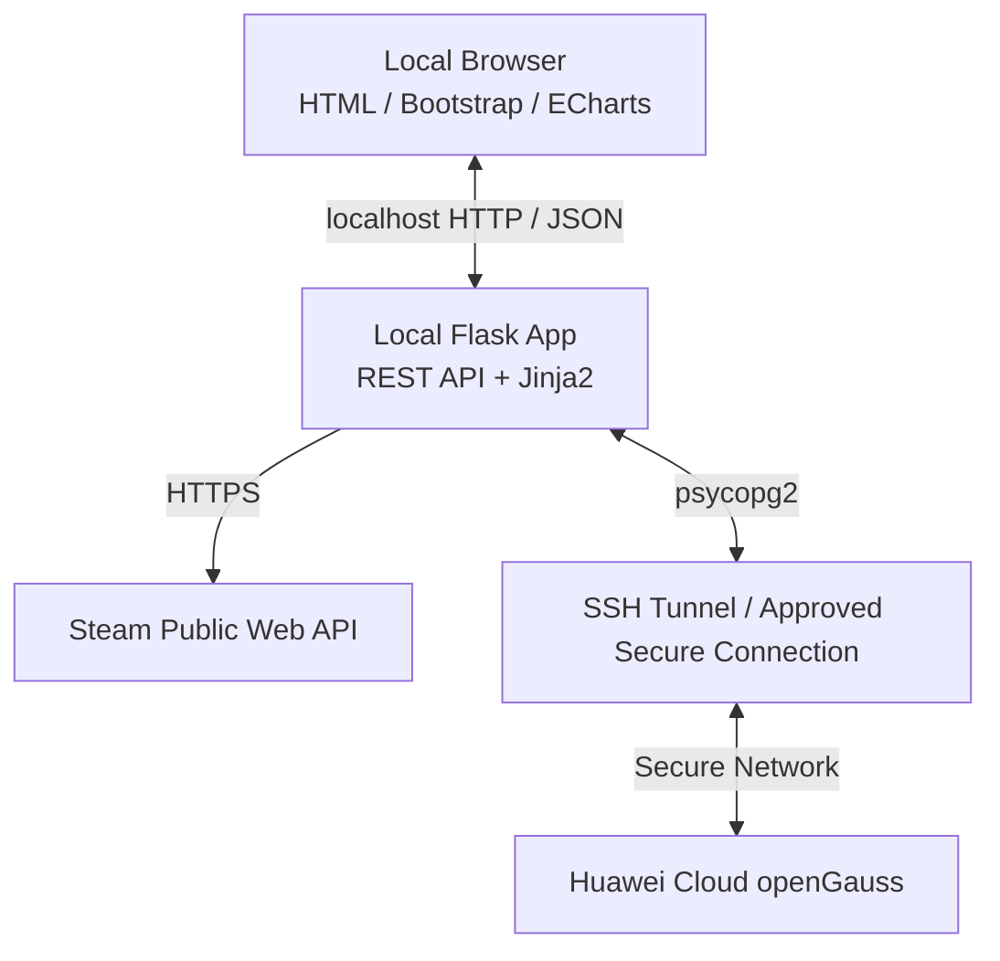
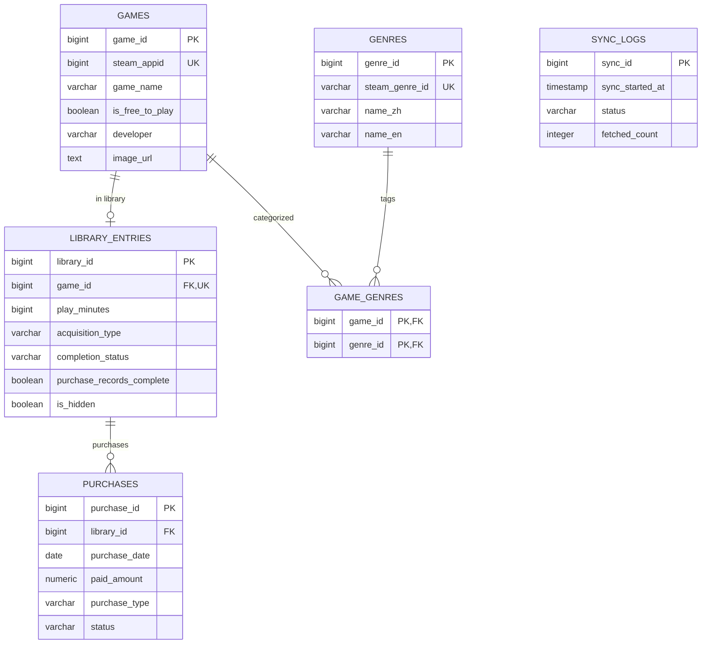

# Steam 个人游戏库与游玩成本分析系统 — 开发计划（PLAN.md）

> 项目版本：v1.0（课程实验三基础版）  
> 开发方式：单人完成；本地 Ubuntu 22.04 LTS 运行 Flask，远程连接华为云 openGauss  
> **本地操作系统：Ubuntu 22.04 LTS（用户已确认）**  
> 技术栈：Python 3.11 + uv + Flask + psycopg2 + HTML + Bootstrap + JavaScript + ECharts  
> 数据来源：Steam Web API 为主；真实购买信息由用户选择性补充  
> 本文件与同目录 `AGENTS.md` 配套使用，开发 Agent 必须同时遵守。

## 0. 最高优先级：分步实现、逐步审查

**每完成一个可独立验收的步骤，Agent 必须停止开发并提交审查。未经用户明确回复“通过，继续下一步”或表达同等明确授权，不得继续下一步骤、提前实现其他模块或顺便重构无关代码。**

每次审查至少提供：

1. 本步目标和实际完成的文件/功能（附文件路径）。
2. 实际运行或测试命令、结果；失败必须如实披露。
3. 可供用户观察的效果：页面截图、实际页面访问地址、终端输出、SQL 查询结果之一或多个。若无截图工具，不得假称已截图，提供准确复现方式。
4. 用户应当检查什么（含预期输出和边界条件）。
5. 未完成事项、风险和下一步候选任务。
6. 末尾明确提问：**“请审查本步效果。回复‘通过，继续下一步’或列出需要修改的问题。”**

如审查未通过，只修复当前步骤并重新提交审查。不要在一次任务中连做多个已排定的阶段。

### 0.1 Git 版本管理与用户审查门禁

**Git 是项目必需工具，不再只是推荐工具。严格遵守用户提供的 `git-commit-rules` 技能。** 原版技能放入项目 `.agents/skills/git-commit-rules/SKILL.md`；该文件应保持与用户上传版本一致。无论 Agent 平台是否自动发现技能，**在每一次执行 `git add` 或 `git commit` 之前，都必须重新打开并完整阅读该文件**。

统一工作顺序：

```text
开始当前获准的单一阶段
  → 仅修改本阶段范围内的文件
  → 执行相关测试、git diff --check、git status
  → 向用户展示效果、测试与未提交 diff，暂停
  → 用户明确批准
  → 将本阶段验收框更新为 [x]（并入本阶段提交）
  → 再次阅读 git-commit-rules/SKILL.md
  → git status
  → git add <本阶段具体路径>（逐项列出）
  → git diff --cached --stat（必须核对）
  → 检查 staged diff 与敏感文件
  → 创建一个完整、可用的原子 commit
  → git status 核查
  → 按授权开始下一阶段
```

- 初次启动 S0 时，在**真正的项目根目录**检查 `git rev-parse --is-inside-work-tree`；如未处于 Git 仓库，可执行 `git init -b main`。若已经是仓库，沿用原仓库，**不得重新初始化或覆盖历史**。
- Git 作者姓名、邮箱由用户自行设置；Agent 不得猜测、伪造或自动修改全局 `user.name` / `user.email`。
- **审查前禁止 `git add`、`git commit` 和自动 push**，保留工作区差异方便用户确认。用户明确批准后方可暂存/提交。
- 始终先 `git status`；只允许 `git add <明确路径>`，**禁止** `git add .`、`git add -A`、`git add --all`、`git add *`；暂存后必须执行 `git diff --cached --stat`。
- 一项不可分割的任务对应一个原子、完整、可运行的提交；多项独立任务分别提交；严禁提交已知损坏的代码和制造 fix-up commits。
- 提交标题为英文祈使句、**≤72 字符、无结尾句号**，概括行为变化而非文件名称；正文原则上解释为什么更改，标题已完全自明的简单变更可省略正文。
- 不在提交正文中重复构建步骤、明显实现细节、测试通过等信息；只描述相对父提交的最终状态及非显然约束。
- 若本地新改动只是“补全/修复上一提交”，根据技能要求应合并进上一原子提交，**不能另起修补提交**。若相关历史已经推送，任何 reset/--amend/强制推送之前必须先征求用户明确批准。
- 探索性实验使用 `temp/`、`wip/` 或 `scratch/` 分支；禁止直接合并这些实验分支，应整理成干净的原子提交。
- `git push`、添加远端、创建远程仓库、发布均非基础阶段的自动动作，只有用户明确要求才执行；默认使用本地 Git。
- 若用户未批准本阶段，继续修改未提交的当前阶段代码，**不得提前提交再以 fix-up 补救**。

**审查和 Git 提交是两个不同的门禁**：自动化测试通过不代表用户批准；用户批准前不得将改动提交。只有获得明确批准后才能创建相应原子提交。

## 1. 项目目标与范围

### 1.1 项目目标

实现一个能自动导入 Steam 游戏库、管理个人游戏和实际消费、分析“买了没玩”等趣味指标的 B/S 数据库应用。满足《数据库应用实践》实验三中的需求分析、E-R 图、关系表设计、插入/删除/修改/查询/统计查询、前后端数据库连接和界面截图要求。

### 1.2 必须实现（MVP）

- Steam 游戏库同步：AppID、游戏名称、图标（若接口返回）、累计游玩分钟数；支持重复同步、失败记录和隐私/网络异常提示。
- 本地游戏 CRUD：新增手动游戏、查询/搜索/筛选、修改用户可编辑字段、删除手动游戏或隐藏已同步游戏。
- 购买记录 CRUD：游戏对应多笔购买记录；购买日期、实际支付金额、退款状态、基础游戏/DLC。
- 免费游戏：区分永久免费、免费领取、礼物、付费、获取方式未知；处理 0 元与“价格未知”的差异。
- 中英文界面：简体中文与 English，所有导航/按钮/表头/筛选/状态/空状态/错误文案/图表标题和图例可切换，记住语言选择。
- 统计分析：题材时长占比、未启动率、非适用游戏排除后的未通关分析、每小时成本排行榜、付费吃灰榜、年度消费趋势。
- 数据库：华为云 openGauss；至少 6 张关系表；主外键、唯一性、非空、默认值、CHECK、索引、参数化 SQL 和事务。
- 测试与课程报告材料：运行说明、E-R 图、表说明、关键 SQL、真实功能截图、结果分析和个人开发总结。

### 1.3 明确不在 v1.0 范围

- Steam 登录/密码托管、多人账户系统、社交/好友、云部署 Flask。
- 自动读取真实历史购买金额（Steam 游戏库 API 不提供）、绕过隐私限制。
- Steam 成就同步、后台定时任务、游玩快照时间序列、复杂推荐算法。
- React/Vue、Node.js/npm 构建系统、Docker、Redis、Celery、SQLAlchemy/Alembic。
- 未经批准的网页爬虫、自动抓取 Steam 账号隐私页面。

**课程演示优先保证“可用 CRUD + 真实数据库统计 + 同步链路”，避免超出单人 16 学时的工作量。**

## 2. 部署与架构



- **开发机固定为 Ubuntu 22.04 LTS**，命令使用 Bash；项目 Python 3.11 由 uv 独立管理，不替换系统默认 Python。
- 统一从本地 `127.0.0.1:5000` 访问 Flask，前后端同源，原则上不需要 CORS 依赖。
- Steam API Key 仅放在后端 `.env`，不得出现在浏览器资源、日志、报错、提交文件中。
- 若数据库在华为云 ECS，优先 SSH 端口转发：本地 `127.0.0.1:15432` → ECS 内网数据库监听地址/端口（如 26000，具体以实际为准）。
- 若数据库是托管实例，依实例连接方式配置安全访问；**不得在未确认实例类型之前修改服务器网络规则**。
- 不对公网监听 Flask，不开放 openGauss 数据库端口到 `0.0.0.0/0`。
- 完成实际数据库连接验证前，不假定 Python 驱动与 openGauss 完全兼容。

## 3. 完整依赖清单与安装方式

### 3.1 本地必须具备的软件

| 名称 | 用途 | 安装方式/备注 |
|---|---|---|
| `uv` | Python、虚拟环境和依赖管理 | Ubuntu 22.04 使用官方 Linux 安装器 |
| Python 3.11 | 项目运行环境 | `uv python install 3.11`；不修改 Ubuntu 系统 Python |
| 浏览器（Edge/Chrome/Firefox） | 打开前端页面 | 通常已安装 |
| `openssh-client` | ECS SSH 隧道 | Ubuntu 可通过 `sudo apt install openssh-client` 安装 |
| VS Code 或其他编辑器 | 编写和审查代码 | 推荐，非运行时依赖 |
| gsql / Data Studio 等数据库客户端 | 管理数据库、截图 SQL 结果 | 建议安装其一；Python 连接成功后并非程序运行必需 |
| Git | 本地仓库、阶段差异审查、原子提交、回滚 | **必须安装**；Ubuntu 使用 `sudo apt install git` |
| openGauss | 关系数据库服务 | **已在华为云运行，本地不重复安装** |

### 3.1.1 Ubuntu 22.04 LTS 首次环境准备

> 以下命令仅用于**你自己的 Ubuntu 开发机**，不要在华为云服务器上盲目执行。需要 `sudo` 的命令可能提示输入本机账户密码。若工具已安装，先检查版本，不需要重复安装。

```bash
# 1. 验证操作系统与基础工具
lsb_release -ds
uname -m
ssh -V
git --version

# 2. 仅在缺少工具时安装基础依赖
sudo apt update
sudo apt install -y curl ca-certificates openssh-client git

# 3. 安装 uv（官方 Linux/macOS 安装方式）
curl -LsSf https://astral.sh/uv/install.sh | sh

# 4. 如果新开终端后仍找不到 uv，可临时补充 PATH
export PATH="$HOME/.local/bin:$PATH"

# 5. 验证 uv，再用 uv 安装项目使用的 Python 3.11
uv --version
uv python install 3.11
uv python list
```

安装器来自 uv 官方文档。Ubuntu 22.04 系统自带的 Python 版本与项目要求的 3.11 可能不同，**无需修改 `/usr/bin/python3`，也不要执行 `sudo pip install ...`**。之后按 3.4 节初始化项目。

若 `curl` 下载失败，先检查 DNS、HTTPS 访问和网络代理，不擅自换用不明第三方安装源。

### 3.2 Python 直接依赖（由 uv 管理）

| 包 | 分类 | 作用 | 是否必须 |
|---|---|---|---|
| `flask` | 运行依赖 | Web 路由、模板渲染、API | 是 |
| `requests` | 运行依赖 | Steam HTTPS 请求 | 是 |
| `python-dotenv` | 运行依赖 | 从 `.env` 加载私密配置 | 是 |
| `psycopg2-binary` | 运行依赖（候选驱动） | Python ↔ openGauss 连接 | 先安装、必须实测兼容；不兼容时停止并申请替代方案 |
| `pytest` | 开发依赖 | 单元测试、接口/服务测试 | 是 |
| `ruff` | 开发依赖 | Python 静态检查和格式化 | 是 |

说明：

- `jinja2`、`werkzeug` 等通常随 Flask 作为传递依赖自动安装，**无需重复手动添加**。
- Python 标准库 `os`、`json`、`datetime`、`decimal`、`logging`、`pathlib` 等无需安装。
- 当前范围不需额外安装 `Flask-CORS`、`Flask-SQLAlchemy`、`SQLAlchemy`、`pandas`、`matplotlib`、`beautifulsoup4` 等。
- openGauss 官方文档的部分预编译 psycopg2 包对应旧 Python 版本；先测试 `psycopg2-binary` 能否真实执行 `SELECT 1`。如果失败，记录具体错误并经用户批准后选择兼容驱动/编译策略，**不可自行降级 Python 或更换数据库**。
- 如果需要从源码编译数据库驱动，可能额外需要 C 编译器、`pg_config`/对应 libpq 开发文件等系统依赖，具体依操作系统再决定，不预装。

### 3.3 前端第三方资源（无需 npm）

| 资源 | 用途 | 获取建议 |
|---|---|---|
| Bootstrap 5（编译好的 CSS/JS） | 布局、表单、表格、按钮、模态框 | 下载官方发行版放进 `static/vendor/bootstrap/` |
| Apache ECharts（JS 文件） | 饼图、柱形图、折线图 | 下载官方构建放进 `static/vendor/echarts/` |
| 系统字体 / 浏览器内置图标方案 | 基础显示 | 无需额外下载字体 |

- 优先本地静态资源，确保页面不依赖 CDN；保留资源版本及必要许可声明。
- 不通过 `uv` 安装 Bootstrap/ECharts，也不需要 Node.js/npm。

### 3.4 推荐初始化命令

先完成 3.1.1 节中的 Ubuntu 环境准备，然后：

```bash
uv --version
uv python install 3.11
uv init --no-package steam-library
cd steam-library
uv python pin 3.11

uv add flask requests python-dotenv psycopg2-binary
uv add --dev pytest ruff

uv sync
uv run python -c "import flask, requests, dotenv, psycopg2; print('dependencies ok')"
uv run pytest
uv run ruff check .
```

> 首次没有测试文件时，`pytest` 可能返回“没有收集到测试”；不能将其表述为“所有测试通过”。初始化阶段应先加入一个简单的 smoke test。

以后统一采用 `uv run python app.py` 启动程序，使用 `uv add`/`uv remove` 管理依赖、提交 `pyproject.toml` 与 `uv.lock`，不要在项目内直接手动 `pip install`。

### 3.4.1 Git 初始化和技能接入（属于 S0）

下列操作只在**用户真实的项目目录**执行一次；如果目录已有 Git 仓库则跳过 `git init`：

```bash
git rev-parse --is-inside-work-tree
# 仅当上面的命令表明当前不是 Git 仓库：
git init -b main

git status
git check-ignore .env
```

将用户上传的原版技能放在：

```text
.agents/skills/git-commit-rules/SKILL.md
```

`AGENTS.md` 将强制所有后续开发 Agent 在**每次 `git add` / `git commit` 前**重新阅读该文件。S0 开发完成后，先给用户检查实际运行结果和工作区 diff，**获得明确批准才允许首个提交**。不在初始化时自动执行 `git add`、`git commit` 或 `git push`。

### 3.4.2 Ubuntu 上的 SSH 隧道示例（仅 ECS 自建 openGauss）

先与用户确认数据库部署类型、SSH 用户、ECS 公网地址、数据库监听地址和实际端口。若确实使用华为云 ECS，且数据库在 ECS 自身的 `127.0.0.1:26000` 上监听，可执行：

```bash
ssh -N -L 15432:127.0.0.1:26000 <ssh_user>@<ecs_public_ip>
```

- 这条命令要在**本地 Ubuntu 终端**执行，运行时保持终端连接。
- `26000` 为示例数据库端口，`127.0.0.1` 是**从 SSH 服务器角度看到的数据库监听地址**；不能在未核实部署方式和监听地址时照抄。
- SSH 连接建议使用密钥并在云端安全组中限制来源 IP；不要开放数据库端口给所有公网地址。
- 如数据库不在同一台 ECS 上、是托管实例、使用跳板机或采用 SSL 直连，**应先确认架构并改用相应的安全连接方式**。
- 隧道建立后，应用 `.env` 使用 `DB_HOST=127.0.0.1` 和 `DB_PORT=15432`；下一阶段用真实 `SELECT 1` 验证，不能把 SSH 建立成功等同于数据库登录成功。

### 3.5 外部账号/服务与配置（不是 Python 依赖）

- 有效的 SteamID64。
- 可用于公共 Web API 的 Steam Web API Key（由用户自行获得，勿让用户提供明文给 Agent）。
- 可访问的 Steam 游戏详情隐私设置；需正确处理不公开导致的缺失。
- 华为云数据库类型、实例/主机地址、实际端口、数据库名称、**最小权限业务账户**。
- 若走 ECS 隧道，需要 SSH 访问条件；不要把 SSH 私钥、数据库口令或密钥提交进仓库。

`.env.example`（只放占位符）：

```dotenv
FLASK_HOST=127.0.0.1
FLASK_PORT=5000
FLASK_DEBUG=false

DB_HOST=127.0.0.1
DB_PORT=15432
DB_NAME=steam_library
DB_USER=steam_app
DB_PASSWORD=REPLACE_ME
DB_SSLMODE=prefer

STEAM_API_KEY=REPLACE_ME
STEAM_ID64=REPLACE_ME
STEAM_HTTP_TIMEOUT=20
```

`.gitignore` 至少包含：`.env`、`.env.*`（但保留 `.env.example`）、`.venv/`、`__pycache__/`、`.pytest_cache/`、`.ruff_cache/`、`*.pyc`、`*.log`、私密数据与密钥目录；不要忽略 `uv.lock`、`PLAN.md`、`AGENTS.md` 和 `.agents/skills/git-commit-rules/SKILL.md`。技能文件进入版本控制，确保新 Agent 可以读到相同规则。

## 4. 数据库设计（6 张核心表）

以下是最终结构约定，物理建表前先确认实际 openGauss 版本与语法兼容性，**不要直接在有重要数据的库里运行 DROP/重建脚本**。

### 4.1 E-R 概念图



### 4.2 各表的必需字段与约束

1. `games`：`game_id` PK、`steam_appid BIGINT UNIQUE NULL`、`game_name NOT NULL`、`developer`、`image_url`、`is_free_to_play BOOLEAN NULL`（NULL 表示商店分类未知）、`source`（steam/manual）；`steam_appid` 是同步去重键。
2. `genres`：`genre_id` PK、`steam_genre_id VARCHAR UNIQUE NULL`、`name_zh`、`name_en`；题材双语显示，不复制两套数据。
3. `game_genres`：`game_id`+`genre_id` 联合 PK，均 FK；允许一款游戏有多个题材。
4. `library_entries`：`library_id` PK、`game_id UNIQUE FK`、`play_minutes BIGINT DEFAULT 0 CHECK >= 0`、`acquisition_type`、`completion_status`、`progress_percent SMALLINT NULL CHECK 0..100`、`purchase_records_complete BOOLEAN DEFAULT FALSE`、`is_hidden BOOLEAN DEFAULT FALSE`、`last_synced_at`。Steam API 不提供统一剧情通关进度，**进度/通关状态由用户维护，不可根据时长推断已通关**。
5. `purchases`：`purchase_id` PK、`library_id FK`、`purchase_date`、`paid_amount NUMERIC(10,2) CHECK >= 0`、`purchase_type(base/dlc)`、`status(paid/refunded)`、`notes`；一个游戏可对应多条记录。第一版仅处理人民币、完整退款；部分退款暂不支持。
6. `sync_logs`：`sync_id` PK、`sync_started_at`、`sync_finished_at`、`status(running/success/failed)`、`fetched_count`、`message`；独立日志表，不强造游戏外键。

枚举值作为稳定英文代码存储，而不是中文界面词：
- `acquisition_type`: `unknown`, `paid`, `free_to_play`, `free_claimed`, `gift`。
- `completion_status`: `unknown`, `playing`, `completed`, `abandoned`, `not_applicable`。
- `purchases.status`: `paid`, `refunded`。
- `purchase_type`: `base`, `dlc`。

索引重点：购买日期、`game_genres.genre_id`、Steam AppID（唯一索引自动实现）；不要无根据增加大量索引。

### 4.3 免费/未知成本口径

**绝不把缺失的购买记录自动当成 0 元。**

- `games.is_free_to_play = TRUE` 只表示商店的永久免费标记，不保证该用户从未付费购买 DLC/内容。
- `library_entries.acquisition_type` 描述用户如何获得本体；F2P、免费领取、礼物与未知分开。
- `purchase_records_complete = FALSE` 时，不将现有记录视为“全部支出”；成本结果标记“待补全/不参与精确成本排行”。
- `purchase_records_complete = TRUE` 且有效净购买额 > 0、游玩时长 > 0：参与**付费每小时成本排名**。
- 完整消费记录为 0 且已确认获取方式免费：列入“零成本游戏”，单独展示。
- 消费完整、净支出 > 0、游玩时长为 0：进入“付费吃灰金额榜”，不可除以 0。
- 退款记录不计入当前净消费；不从未有的数据推测购买日期。

### 4.4 自动同步与本地字段冲突

- `GetOwnedGames` 获取 AppID、名称（若开启 appinfo）、游玩分钟数；对已存在 `steam_appid` 使用 Upsert。
- 同步更新只覆盖 Steam 拥有的字段；保留用户填写的获取方式、通关状态、完成进度和消费记录。
- 只有 API 成功且返回可验证数据时才提交；失败不覆盖或删除现有库。
- 对 Steam 数据允许“隐藏”，而非永久删除后下次自动复活；手动游戏可以安全删除或限制删除（如有购买记录先提示）。
- 采用事务处理批量同步；记录 `sync_logs` 成败，报错中不得包含 API Key 或口令。
- Steam 所有权接口可能因为隐私设置而返回空/不完整数据；**绝不对缺失记录做自动批量删除**。

## 5. Steam 数据采集的边界

- 官方公开接口首选 `https://api.steampowered.com/IPlayerService/GetOwnedGames/v1/`；**不要把仅面向发行商的 `partner.steam-api.com` 当成普通账户 API 入口**。
- `include_appinfo=true`；`include_played_free_games=true`。
- `include_played_free_games=true` 只说明“玩过的免费游戏可返回”，**不能保证全部未启动的免费游戏被同步**。
- 若接口无权限、密钥无效、账号资料不可见或请求失败，应显示友好提示并保留本地数据。
- Steam API 无个人真实历史购买价格/日期；这两项必须由用户在购买管理中补录，绝不以商店现价冒充。
- 游戏题材需要额外数据源。优先商店详情补全（失败可回退），并允许在游戏编辑页手动分类。官方接口的稳定性不能与非官方商店详情接口混为一谈。
- 测试允许使用本地固定 JSON 样本，但页面/日志必须明确标为“模拟数据”，不得宣称真实 Steam 同步成功。

## 6. 前后端分层与接口

### 6.1 前端：四个页面

| 页面 | 功能 |
|---|---|
| Dashboard | 总游戏数、总时长、已知消费、未启动率、同步状态 |
| Library | 游戏展示、搜索筛选、编辑题材/状态、手动添加、隐藏/删除、手动同步 |
| Purchases | 单款游戏多笔购买记录，增加/修改/删除，退款和数据完整性标记 |
| Analytics | 题材游玩时长占比、未启动率/未通关率、付费每小时成本、吃灰金额、年度消费 |

双语：默认简体中文；中文/English 一键切换；`localStorage` 记住语言；`data-i18n` 或等效字典统一维护字符串；ECharts 标题、图例和 tooltip 也要翻译。数据状态、外键和 SQL 逻辑不随语言变化。

### 6.2 Flask API 约定

| 方法及路径 | 作用 |
|---|---|
| `GET /api/games` | 游戏列表、分页/搜索/筛选 |
| `POST /api/games` | 新增手动游戏 |
| `GET /api/games/<id>` | 获取详情 |
| `PUT /api/games/<id>` | 修改用户维护字段 |
| `DELETE /api/games/<id>` | 手动游戏删除/Steam 游戏隐藏 |
| `POST /api/steam/sync` | 用户手动触发 Steam 同步 |
| `GET /api/steam/sync-logs` | 查看同步结果 |
| `GET /api/purchases` | 查询购买记录 |
| `POST /api/purchases` | 新增购买记录 |
| `PUT /api/purchases/<id>` | 修改购买记录 |
| `DELETE /api/purchases/<id>` | 删除购买记录 |
| `GET /api/stats/overview` | 总览 KPI |
| `GET /api/stats/genres` | 题材时长占比 |
| `GET /api/stats/costs` | 每小时成本排行榜 |
| `GET /api/stats/yearly` | 年度消费 |

统一返回 JSON；成功/失败 HTTP 状态码合理；异常内容脱敏；所有 SQL 参数化；不直接将异常堆栈返回浏览器。

## 7. 统计定义（避免统计口径争议）

1. **游戏库范围**：当前非隐藏的本地游戏库；由 API 可能漏报的免费游戏，不纳入未发现数据。
2. **未启动率**：`play_minutes = 0` 的非隐藏游戏数 / 非隐藏游戏总数；分母为零时显示“暂无数据”。
3. **未通关率**：只针对有明确完成概念且用户已确认状态的游戏；`not_applicable`、`unknown` 不放入分母；`playing/abandoned` 可计未通关。单独说明“状态待确认”数量。
4. **题材时长占比**：多题材游戏的时长按它拥有的题材数量均分，避免总量重复；无题材归“未分类”。
5. **每小时成本**：`SUM(有效已支付购买额) × 60 / play_minutes`，仅消费记录完整、支出 > 0、时长 > 0 的游戏参与付费排名。按升序最划算、降序最贵。
6. **年度消费趋势**：按 `purchase_date` 所在年分组、使用有效已支付金额；仅反映已记录的数据，界面说明“实际账目可能不完整”。
7. **付费吃灰金额**：消费记录完整、有效支出 > 0 且未启动的游戏支出合计。
8. **免费游戏**：参与数量/游玩时长/未启动率分析；零成本游戏与未知消费游戏均不混入付费成本排行。
9. **人民币**：v1.0 只处理 CNY，暂不做币种汇率计算。

## 8. 推荐项目结构

```text
steam-library/
├── PLAN.md
├── AGENTS.md
├── .agents/
│   └── skills/
│       └── git-commit-rules/
│           └── SKILL.md
├── README.md
├── .python-version
├── pyproject.toml
├── uv.lock
├── .env.example
├── .gitignore
├── app.py
├── config.py
├── database/
│   ├── db.py
│   ├── schema.sql
│   └── queries.sql
├── routes/
│   ├── games.py
│   ├── purchases.py
│   ├── steam.py
│   └── statistics.py
├── services/
│   ├── steam_api.py
│   ├── game_service.py
│   └── stats_service.py
├── templates/
│   ├── base.html
│   ├── dashboard.html
│   ├── library.html
│   ├── purchases.html
│   └── analytics.html
├── static/
│   ├── vendor/bootstrap/
│   ├── vendor/echarts/
│   ├── css/style.css
│   └── js/
│       ├── i18n.js
│       ├── library.js
│       ├── purchases.js
│       └── charts.js
└── tests/
    ├── test_smoke.py
    ├── test_steam_api.py
    ├── test_stats.py
    └── fixtures/
        └── steam_owned_games.json
```

文件按阶段渐进创建，**目录是目标结构，不要求首个阶段一次性生成所有占位文件**。

## 9. 分阶段实施和审查门禁

> 目标为单人课程项目，参考 16 学时；实际耗时受云端网络、数据库版本、Steam 授权影响。**每一行都是独立审查点**。初始状态均为未验收，只有用户通过后才能标记 `[x]`。

| 阶段 | 内容 | 建议时间 | 必交审查证据 |
|---|---|---:|---|
| S0 | Ubuntu 22.04 上用 uv 初始化、创建/复用本地 Git 仓库、接入原版技能、最小 Flask 页面 | 1h | uv/Flask 运行、首页、`.gitignore` 忽略私密文件、`git status` 与未提交差异；获批准后才首个 commit |
| S1 | 从 Ubuntu 到华为云 openGauss 的安全连接及 `SELECT 1` | 2h | SSH/安全连接方式、脱敏 `SELECT 1` 输出、服务端版本、失败排查记录 |
| S2 | 6 张表、外键/约束/索引与 E-R 图 | 2h | 完整 schema.sql、实际表结构和约束查询结果 |
| S3 | Steam API 请求及本地样本测试 | 1.5h | 脱敏响应字段、对免费游戏/接口失败的测试 |
| S4 | API → 数据库同步、去重、日志 | 2h | 第一次/第二次同步记录、SQL 行数一致性 |
| S5 | 游戏库页面及游戏 CRUD、隐藏规则 | 2h | 页面截图/访问路径、CRUD 前后记录变化 |
| S6 | 购买记录 CRUD、免费/未知消费标记 | 1.5h | 已知/未知/免费/退款数据操作与结果 |
| S7 | SQL 统计接口 + ECharts 仪表盘 | 2h | SQL 查询结果、页面图表与数值核对 |
| S8 | 中英文完整切换与测试、实验报告材料 | 2h | 双语对应界面、测试记录、报告截图清单 |
| **合计** | | **16h** | |

- [x] S0 已由用户审查通过
- [x] S1 已由用户审查通过
- [x] S2 已由用户审查通过
- [x] S3 已由用户审查通过
- [x] S4 已由用户审查通过
- [x] S5 已由用户审查通过
- [x] S6 已由用户审查通过
- [ ] S7 已由用户审查通过
- [ ] S8 已由用户审查通过

### 阶段交付统一模板

```markdown
### 本阶段交付审查：Sx - 阶段名称
- 完成内容：
- 修改/新增文件：
- 实际运行命令：
- 测试结果（通过 / 失败 / 未运行及原因）：
- Git 审查证据（未提交）：`git status`、`git diff --stat`、`git diff --check`；如有未追踪文件，明确列出路径：
- 界面/SQL/日志效果：
- 请你重点审查：
- 已知问题与限制：
- 下一阶段（仅说明，不执行）：

请审查本阶段效果。回复“通过，继续下一步”或给出修改意见。
```

## 10. 测试矩阵与验收标准

| 测试 | 预期 |
|---|---|
| openGauss 连接 | Python 真实执行 `SELECT 1` 返回 1 |
| 数据约束 | 负数时长/价格、重复 AppID、无效外键被拒绝 |
| Steam 第一次同步 | 新游戏进入 `games` 和 `library_entries`，记录成功日志 |
| Steam 重复同步 | 行数不重复，时长得到更新 |
| Steam 网络失败/无权限 | 前端提示错误、日志记录失败、本地游戏数据保留 |
| 免费游戏 | F2P 可分类；0 元不等于未知金额 |
| 未启动时长 | 每小时成本无除零错误 |
| 退款 | 退款记录不计有效净支出 |
| 未填写购买价格 | 显示“消费未知”，不能冒充 0 元 |
| 多题材游戏 | 时长均分，题材占比合计合理 |
| CRUD | 各完成一次新增、修改、查询、删除/隐藏 |
| 双语 | 四页以及图表、异常/空状态均可切换 |
| 启动/刷新 | `uv run python app.py` 可本地访问 |
| 安全 | 代码与日志无密钥；数据库无公网不受控暴露 |
| Git 纪律 | 审查前无暂存/提交；批准后只暂存具体路径，检查 staged stat，commit 原子、可用；无自动 push |

测试数据至少覆盖：付费游戏、永久免费、免费领取、礼物、消费未知、已退款、未玩、已玩未通关、已通关、无剧情通关概念、多题材等。真实 Steam 连通前先用模拟 JSON 测试，模拟测试和真实同步分别说明。

## 11. 安全与数据完整性约束

- `.env` 不提交；日志/API 返回值不能泄露 Key、密码、SSH 私钥或完整密钥型请求 URL。
- Git 必须遵循 `.agents/skills/git-commit-rules/SKILL.md`；所有提交在用户审查通过之后，禁止自动 push、无授权历史重写或批量暂存。
- 使用数据库专用业务账户，尽量只授予应用所需表权限，不使用超级用户。
- SQL 一律使用参数绑定；对前端输入做类型、长度、范围检查；前端展示外部游戏文本时转义以避免 XSS。
- 服务器端请求 Steam 使用 HTTPS、超时、有限重试；不得在循环中无限请求。
- 不执行破坏性数据库操作，尤其不针对已有远端数据库执行 `DROP DATABASE`、`TRUNCATE` 或无 WHERE 的 DELETE。
- Flask 只绑定本机回环地址；SSH 隧道或批准的安全连接之外，不建议暴露 openGauss 公网端口。
- 向云端写入模拟数据前告知用户用途和数量，避免覆盖现有重要数据；优先使用专用数据库/schema。

## 12. 课程报告交付目录

依据实验三报告要求准备：

1. 系统选题、需求和**个人独立开发**说明；
2. E-R 图（概念数据模型）；
3. 每张表的字段、主外键、约束和用途；
4. 硬件/操作系统/openGauss/uv/Flask 环境、安装过程、关键数据库连接代码；
5. 主要功能界面实际截图及 CRUD/统计结果；
6. 实验结果、优缺点和改进方向；
7. 不少于 500 字的编程工作总结（仅记录本人实际完成和遇到的问题）。

最终材料建议保留：源代码、`pyproject.toml`、`uv.lock`、数据库 SQL、E-R 图、真实界面截图、README、`PLAN.md`、`AGENTS.md`、原版 Git 技能和报告。Git 的 `.git/` 历史可留在本地用于开发审查；课程最终提交打包规则以教师要求为准，不随意包含真实密钥。提交前移除真实密钥/口令与未经授权的个人数据。

## 13. 外部参考（优先官方文档）

- uv 安装：https://docs.astral.sh/uv/getting-started/installation/
- uv 项目与依赖：https://docs.astral.sh/uv/guides/projects/
- openGauss Python：https://docs.opengauss.org/zh/docs/latest/getting_started/python.html
- Steam Web API 总览：https://partner.steamgames.com/doc/webapi_overview
- Steam GetOwnedGames：https://partner.steamgames.com/doc/webapi/IPlayerService
- Bootstrap 下载：https://getbootstrap.com/docs/5.3/getting-started/download/
- ECharts 下载：https://echarts.apache.org/handbook/en/basics/download/

## 14. 待确认的真实环境信息

开发机系统已经确认是 **Ubuntu 22.04 LTS**。实施 S1 前仍需确认：ECS 自建 openGauss 还是华为云托管实例、**云端服务器**操作系统、数据库版本/端口、SSH 访问方式。**不要要求用户在聊天中发送明文密钥、数据库密码或私钥**；引导用户自行填写本地 `.env`。

> **执行起点：S0。执行完成就停，等待用户检查，不可越过审查门禁。**
