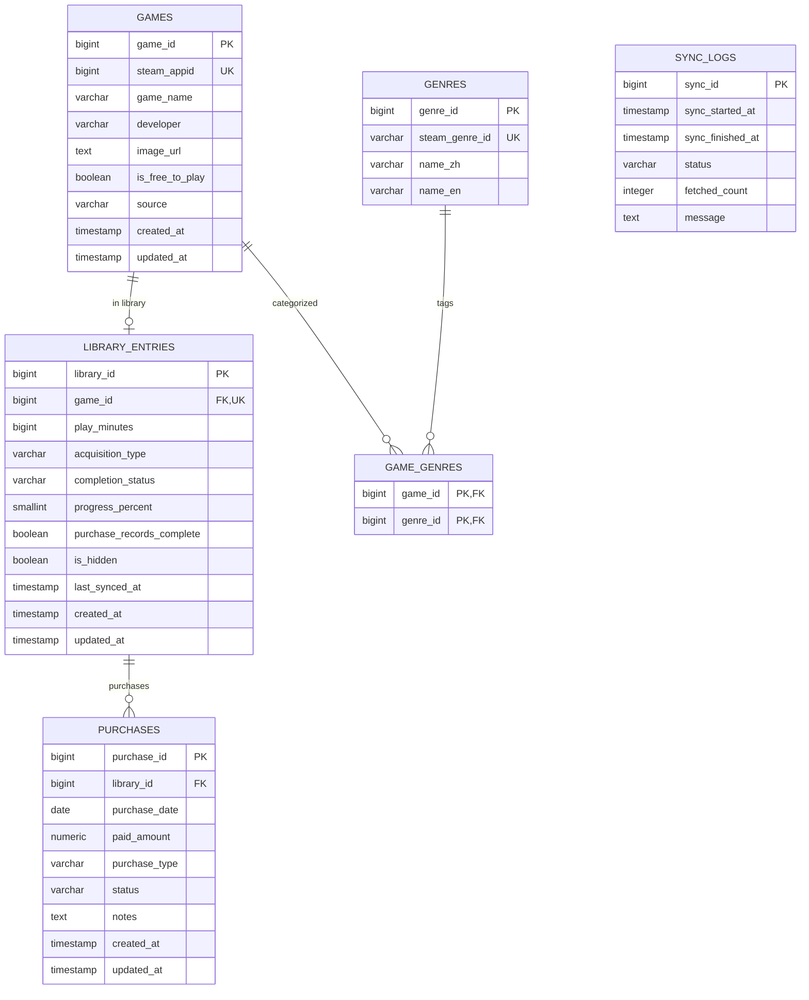

# 数据库设计说明（S2）

- 目标实例：华为云 ECS 上的 openGauss 7.0.0-RC3（Docker 容器）
- 数据库：`steam_library`（专用库，未触碰同实例的 `oj_platform`）
- Schema：`steam`（专用 schema；`steam_app` 对共享 `public` schema 只有 USAGE，
  建表权限统一收敛在 `steam` 内）
- 建表脚本：`database/schema.sql`（幂等，可重复执行，不 DROP/TRUNCATE 数据）
- 真实性验证：`uv run python tests/schema_check.py`

## 1. 概念 E-R 图

关系基数与删除行为：

| 关系 | 基数 | 外键 | ON DELETE |
|---|---|---|---|
| games → library_entries | 1 : 0..1 | `library_entries.game_id` UNIQUE | CASCADE |
| games → game_genres | 1 : 0..n | `game_genres.game_id` | CASCADE |
| genres → game_genres | 1 : 0..n | `game_genres.genre_id` | RESTRICT |
| library_entries → purchases | 1 : 0..n | `purchases.library_id` | CASCADE |

`sync_logs` 独立存在，不设外键——同步失败时即使没有任何游戏行也必须能记日志。

## 2. 约束清单（均已在真实库验证）

| 表 | 约束 | 类型 |
|---|---|---|
| games | `game_id` 主键；`steam_appid` 唯一（同步去重键） | PK / UNIQUE |
| games | `source IN ('steam','manual')` | CHECK |
| genres | `genre_id` PK；`steam_genre_id` UNIQUE（可空） | PK / UNIQUE |
| game_genres | `(game_id, genre_id)` 联合 PK | PK |
| library_entries | `game_id` UNIQUE（一游戏一条拥有记录） | UNIQUE |
| library_entries | `play_minutes >= 0` | CHECK |
| library_entries | `acquisition_type IN (unknown, paid, free_to_play, free_claimed, gift)` | CHECK |
| library_entries | `completion_status IN (unknown, playing, completed, abandoned, not_applicable)` | CHECK |
| library_entries | `progress_percent BETWEEN 0 AND 100`（可空） | CHECK |
| purchases | `paid_amount >= 0` | CHECK |
| purchases | `purchase_type IN ('base','dlc')` | CHECK |
| purchases | `status IN ('paid','refunded')` | CHECK |
| purchases | `purchase_date = date_trunc('day', purchase_date)` | CHECK（见下） |
| sync_logs | `status IN ('running','success','failed')`；`fetched_count >= 0` | CHECK |

索引：唯一键自动建索引；额外只加了两条有明确查询依据的索引
`idx_game_genres_genre`（题材反查）与 `idx_purchases_date`（年度消费趋势）。

## 3. openGauss 平台差异（如实记录）

**`DATE` 类型映射**：openGauss 7.0.0-RC3 的数据库兼容模式为 `A`（Oracle 风格），
`DATE` 在物理上是 `timestamp(0) without time zone`，**不会截断时分秒**。实际测试：
向 `DATE` 列插入 `TIMESTAMP '2026-03-15 14:37:59'` 会原样保留时间。

处理方式：保留 `purchase_date DATE` 语义，并加约束
`CHECK (purchase_date = date_trunc('day', purchase_date))`，
强制购买日期只有"日"粒度。已验证：带时分秒被拒绝（`23514`），
`DATE '2026-03-15'` 正常接受。统计 SQL 仍以 `purchase_date` 按年/月分组，
不依赖物理类型名。

## 4. 数据口径备忘（来自 PLAN.md §4.3，建表时已体现）

- `games.is_free_to_play` 是商店标记，`library_entries.acquisition_type` 是个人获取方式，**两者不可混用**。
- `purchase_records_complete` 默认 `FALSE`；未标完整前不得当作"全部支出"。
- 无购买记录 **不等于** 0 元，不能进入付费成本排行。
- 退款记录保留但排除出净支出计算。
- `progress_percent` / `completion_status` 由用户维护，**不得由游玩时长推断**。
